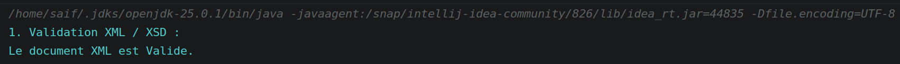
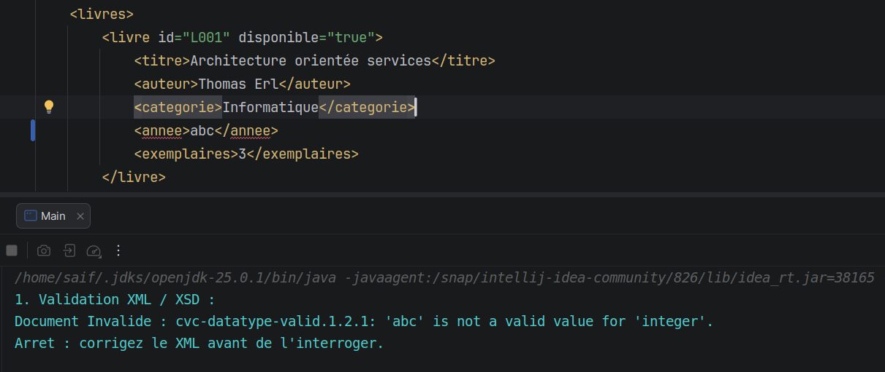
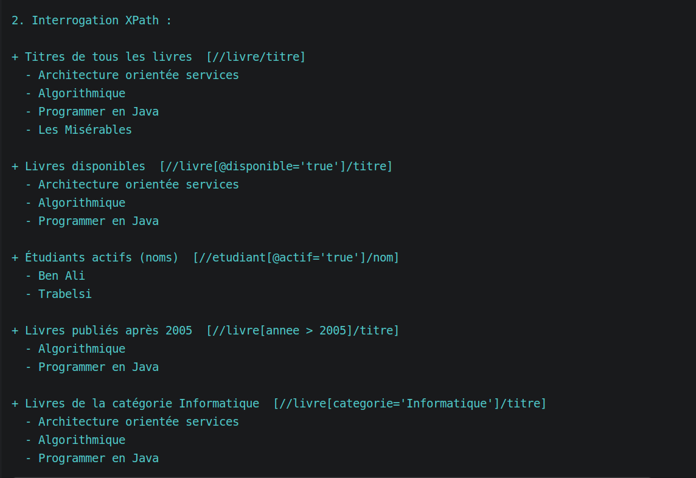
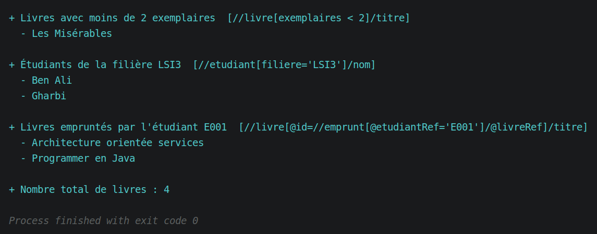

# TP1 – Modélisation XML et interrogation XPath (Maven / Java)

**Matière :** Architecture SOA et services web – **Filière :** LSI3
**Réalisé par :** Triki Saifeddin
**Domaine :** Bibliothèque universitaire

## 1. Structure de la modélisation

Le document "bibliotheque.xml" contient trois entités :

| Entité | Attributs | Éléments |
|---|---|---|
| **Livre** | id, disponible | titre, auteur (1 ou plusieurs), categorie, annee, exemplaires |
| **Étudiant** | id, actif | nom, prenom, filiere |
| **Emprunt** | livreRef, etudiantRef | dateEmprunt, dateRetourPrevue |

```xml
<bibliotheque>
  <livres>
    <livre id="L001" disponible="true">
      <titre>Architecture orientée services</titre>
      <auteur>Thomas Erl</auteur>
      <categorie>Informatique</categorie>
      <annee>2005</annee>
      <exemplaires>3</exemplaires>
    </livre>
  </livres>
    
  <etudiants>
    <etudiant id="E001" actif="true">
      <nom>Ben Ali</nom><prenom>Sara</prenom><filiere>LSI3</filiere>
    </etudiant>
  </etudiants>
    
  <emprunts>
    <emprunt livreRef="L001" etudiantRef="E001">
      <dateEmprunt>2026-10-01</dateEmprunt>
      <dateRetourPrevue>2026-10-15</dateRetourPrevue>
    </emprunt>
  </emprunts>
</bibliotheque>
```

## 2. Choix de conception

- **Attributs vs éléments :** attributs pour les identifiants et indicateurs _(id, disponible, actif)_, éléments pour les données _(titre, nom…)_.
- **Relations :** un emprunt relie un étudiant et un livre par des références _(xs:IDREF)_, comme une clé étrangère. Les _id_ sont uniques (_xs:ID_).
- **Contraintes du XSD :** _categorie_ et _filiere_ limitées à une liste de valeurs, _annee_ entre _1400_ et _2100_, dates au format _xs:date_, _exemplaires_ entier positif ou nul.
- **Cardinalités :** un livre a au moins un auteur (_maxOccurs="unbounded"_), la liste des emprunts peut être vide (_minOccurs="0"_).

## 3. Fonctionnalités de la classe "Main"

1. **Validation XML/XSD** avec "SchemaFactory" et "Validator".



2. **Interrogation XPath** avec "XPathFactory" et "XPathExpression".



## 4. Exemples de requêtes XPath

| Requête XPath | Signification | Résultat |
|---|---|---|
| _//livre/titre_ | Tous les titres de livres | les 4 titres |
| _//livre[@disponible='true']/titre_ | Livres disponibles | Architecture orientée services, Algorithmique, Programmer en Java |
| _//etudiant[@actif='true']/nom_ | Étudiants actifs | Ben Ali, Trabelsi |
| _//livre[annee > 2005]/titre_ | Livres publiés après 2005 | Algorithmique, Programmer en Java |
| _//etudiant[filiere='LSI3']/nom_ | Étudiants de LSI3 | Ben Ali, Gharbi |
| _//livre[@id=//emprunt[@etudiantRef='E001']/@livreRef]/titre_ | Livres empruntés par E001 (jointure) | Architecture orientée services, Programmer en Java |
| _count(//livre)_ | Nombre de livres | 4 |

<!-- cap 3 : résultats des requêtes XPath dans la console IntelliJ -->


